<p align="center">
  
</p>

<h1 align="center">SyncPlay</h1>

<p align="center">
  <strong>One song on every speaker in your home, at the same time.</strong><br>
  Bluetooth speakers, Google Cast speakers and phones you already own, playing as one sound system.<br>
  Music, films and TV shows. For Windows 10 and 11.
</p>

<p align="center">
  <a href="https://github.com/prateek-upreti/syncplay-in/releases/latest"><strong>Download for Windows</strong></a> ·
  <a href="https://syncplay.in">Website</a> ·
  <a href="#screenshots">Screenshots</a> ·
  <a href="https://github.com/prateek-upreti/syncplay-in/issues">Report a problem</a>
</p>

<p align="center">
  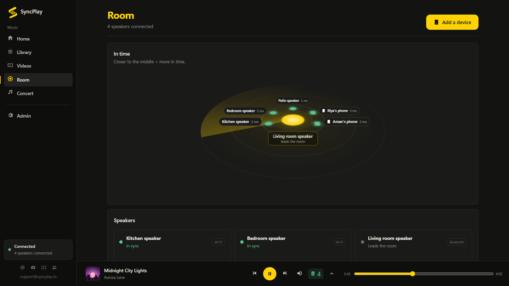
</p>

## Why SyncPlay

Windows can send sound to more than one speaker, but it cannot keep them together. Every speaker adds its own delay, so two speakers playing the same song sound like an echo.

SyncPlay measures each speaker's delay and keeps every speaker in step while the music plays, with tiny speed corrections instead of skips. You hear one clean sound.

## What you can do

- **Play music on every speaker at once**: Bluetooth, wired and Google Cast speakers (such as Nest), from your own music library.
- **Watch your own films and TV shows** on this PC with the sound on every speaker, voices in time with lips. Continue watching, seasons and episodes, subtitles and My List.
- **Play from any app** (Windows 11): whatever the computer is playing, on every speaker.
- **Turn a phone into a speaker**: scan a QR code and it plays in the phone's browser, with nothing to install.
- **Let guests request songs**: people on your Wi-Fi search your library from their phones and ask for a song. Nothing plays until you say yes.
- **Live Concert**: AI on your own PC splits a song into six parts (vocals, drums, bass, guitar, piano and the rest), and each speaker plays its own part.
- **Line your speakers up** with the laptop's microphone, or by ear with a click test, and lock the result.
- **Control the room from one place**: volume and pause for each speaker on the mixing desk, from the PC or from your phone once you sign in.

## Screenshots

<table>
  <tr>
    <td width="50%">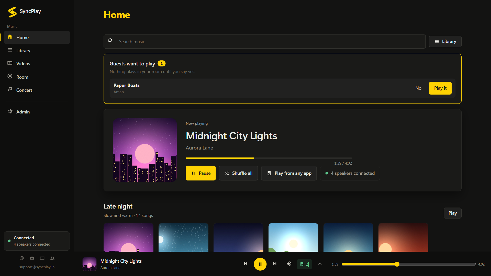<br><sub><b>Home</b>: what is playing, guests' requests, Play from any app</sub></td>
    <td width="50%">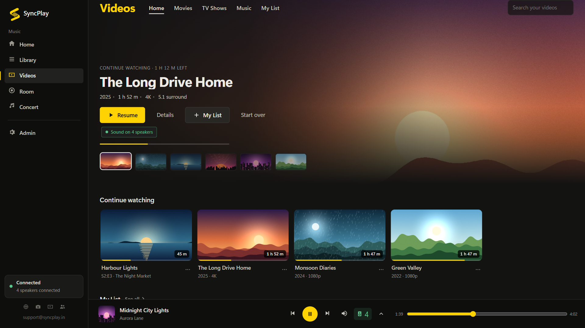<br><sub><b>Videos</b>: your own films and TV shows</sub></td>
  </tr>
  <tr>
    <td>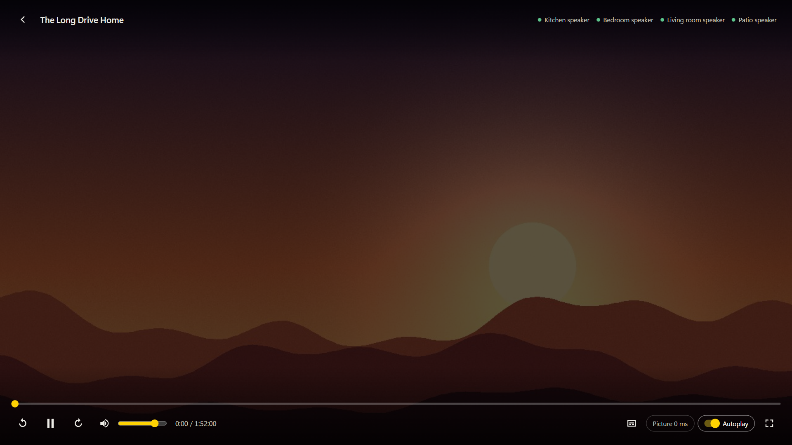<br><sub><b>Watching</b>: the sound on every speaker</sub></td>
    <td>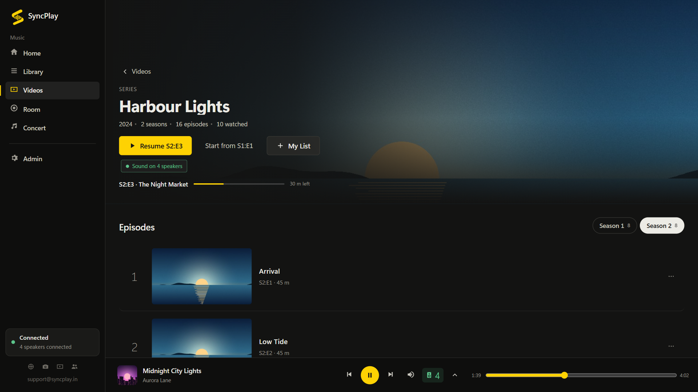<br><sub><b>TV shows</b>: seasons, episodes, resume where you stopped</sub></td>
  </tr>
  <tr>
    <td>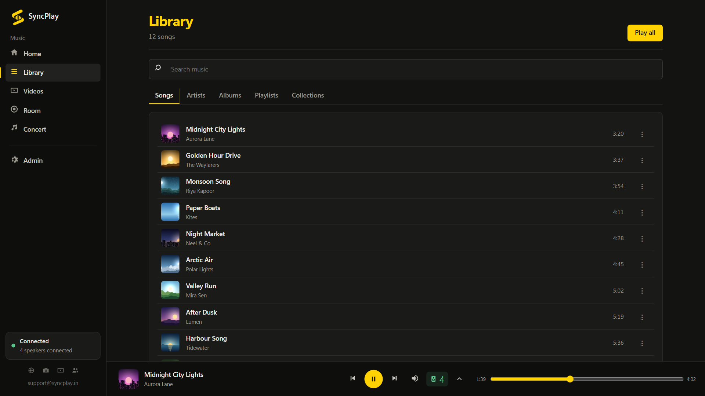<br><sub><b>Library</b>: songs, artists, albums, playlists</sub></td>
    <td>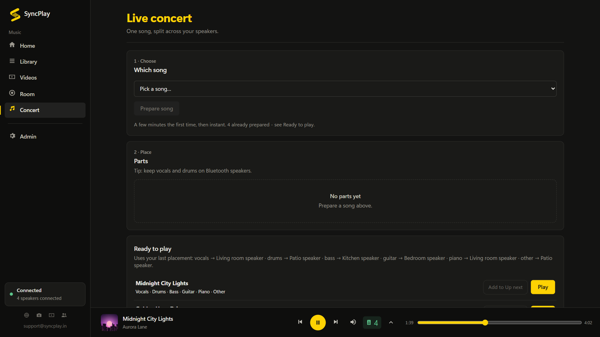<br><sub><b>Live Concert</b>: one song, split across your speakers</sub></td>
  </tr>
  <tr>
    <td>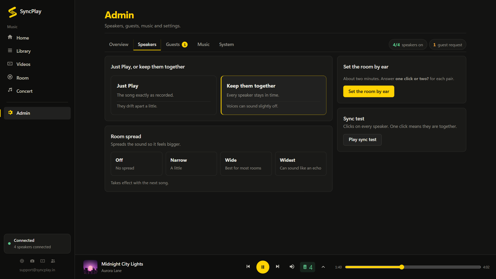<br><sub><b>Speaker timing</b>: by ear, sync test, room spread</sub></td>
    <td>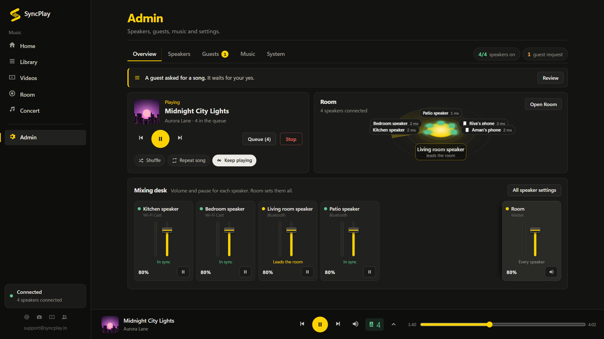<br><sub><b>Admin</b>: the room at a glance and the mixing desk</sub></td>
  </tr>
</table>

<table>
  <tr>
    <td align="center" width="33%">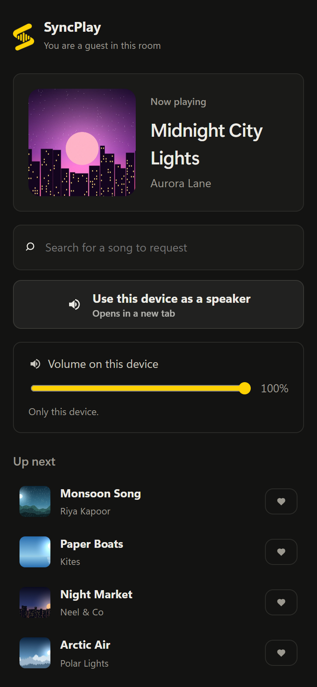<br><sub><b>A guest's phone</b>: search, request, own volume</sub></td>
    <td align="center" width="33%">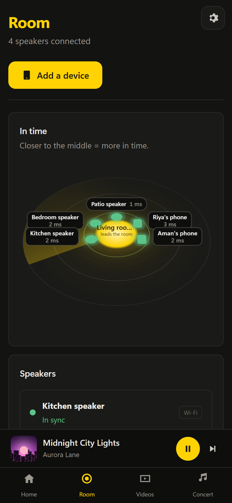<br><sub><b>The Room on a phone</b></sub></td>
    <td align="center" width="33%">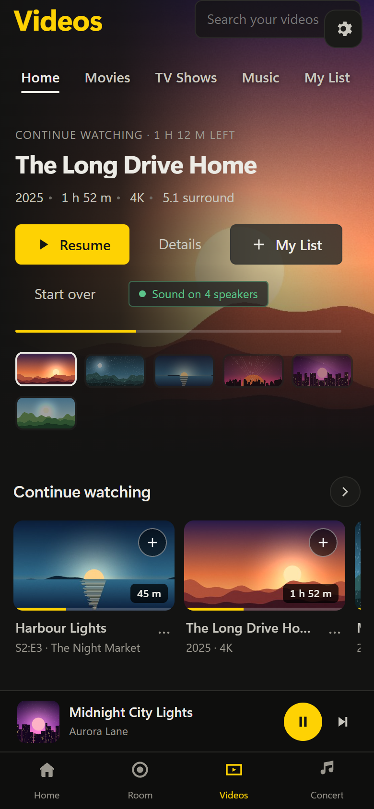<br><sub><b>Videos on a phone</b></sub></td>
  </tr>
</table>

<sub>Screenshots use made-up songs, films, speakers and names.</sub>

## Download and install

1. Download **`SyncPlay-Setup-<version>.exe`** from the [latest release](https://github.com/prateek-upreti/syncplay-in/releases/latest). Download SyncPlay only from this page or [syncplay.in](https://syncplay.in).
2. Check the file (recommended). In PowerShell, in the folder you downloaded it to, run:
   ```powershell
   Get-FileHash .\SyncPlay-Setup-*.exe -Algorithm SHA256
   ```
   The result must match the SHA-256 in the release notes. If it does not, do not run the file, and tell us.
3. Run the installer. It installs for your Windows user only and needs no administrator rights. The installer is not code-signed yet, so Windows SmartScreen may say "Windows protected your PC". If the SHA-256 matched, choose **More info**, then **Run anyway**.
4. Start SyncPlay. If Windows asks, allow it on **private** networks, so phones and Cast speakers can reach it.
5. In **Room**, press **Add a device** to add your speakers, then play something.

**Updating:** run the new installer. Your speakers, timing and settings are kept.

**Uninstalling:** Windows **Settings → Apps → Installed apps → SyncPlay → Uninstall**.

## Requirements

- Windows 10 (version 1809 or later) or Windows 11, 64-bit. **Play from any app** needs Windows 11.
- 4 GB of memory; 8 GB for Live Concert.
- Bluetooth speakers paired in Windows. Most PCs can play to about four Bluetooth speakers at once; that is a limit of the Bluetooth radio.
- Google Cast speakers and phones on the same Wi-Fi network as the PC.
- Optional: a microphone, to measure speaker delays. Windows asks your permission first.
- Optional: Live Concert needs a one-time download of about 2.5 GB. SyncPlay asks before downloading anything.

## Free and Pro

SyncPlay is free to download and free for ever on one speaker.

| | Free | Pro |
|---|:---:|:---:|
| Speakers | 1, any kind | Up to 4 Bluetooth and any number of Google Cast |
| Phones as speakers | – | Any number |
| Live Concert | – | ✓ |

Music, films and TV shows, and guests' song requests are in both.

Pro is a subscription, bought on [syncplay.in](https://syncplay.in/buy):

- India: ₹49 a month or ₹399 a year
- Other countries: US$2.99 a month or US$11 a year

Every new account gets Pro free for 14 days, with no card. You can cancel any time; Pro stays on until the end of the period already paid for.

## Privacy and security

- Your music, films and recordings stay on your computer. Playing needs no internet.
- The microphone is used only to measure speaker delays, on your computer.
- Guests' phones can only search, request songs and set their own volume. Speakers, timing and settings stay with the owner.
- Pro checks its licence online from time to time. See the [privacy policy](https://syncplay.in/legal/privacy).
- Protected (DRM) content stays protected. SyncPlay never bypasses it.

Found a security problem? Please do not open a public issue; see [SECURITY.md](SECURITY.md).

## Help

- **Problems and ideas:** [open an issue](https://github.com/prateek-upreti/syncplay-in/issues/new/choose). Please include the SyncPlay version (Admin → System), your Windows version and your speaker models.
- **Email:** support@syncplay.in
- More in [SUPPORT.md](SUPPORT.md).

## About this repository

This repository holds SyncPlay's releases, release notes and issue tracker. The app's source code is not published here. Terms of use: [syncplay.in/legal/terms](https://syncplay.in/legal/terms).

If SyncPlay is useful to you, a star helps other people find it.

<sub>SyncPlay is not affiliated with Google, Microsoft or the open-source Syncplay project. Google Cast and Nest are trademarks of Google LLC. Bluetooth is a registered trademark of Bluetooth SIG, Inc. © 2026 SyncPlay.</sub>
